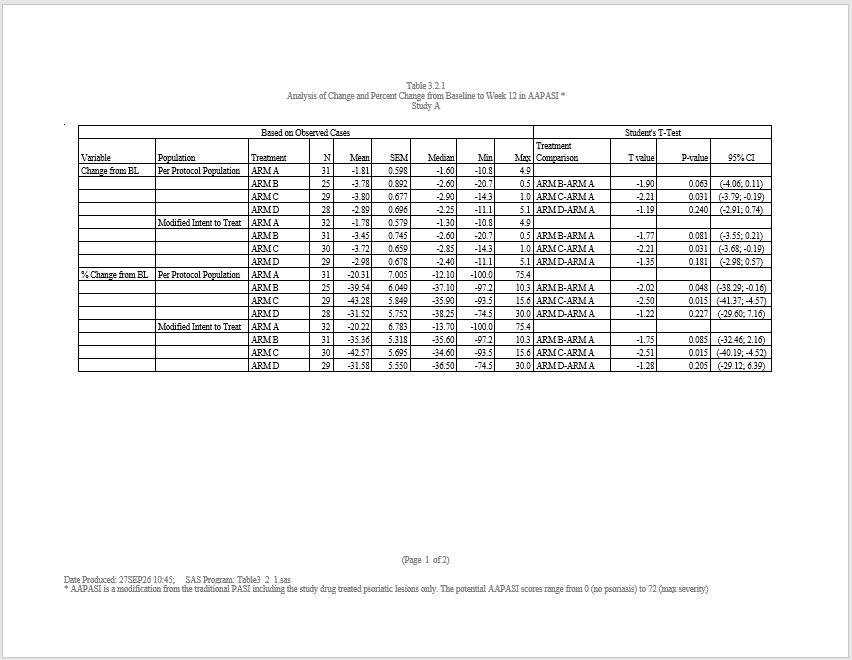
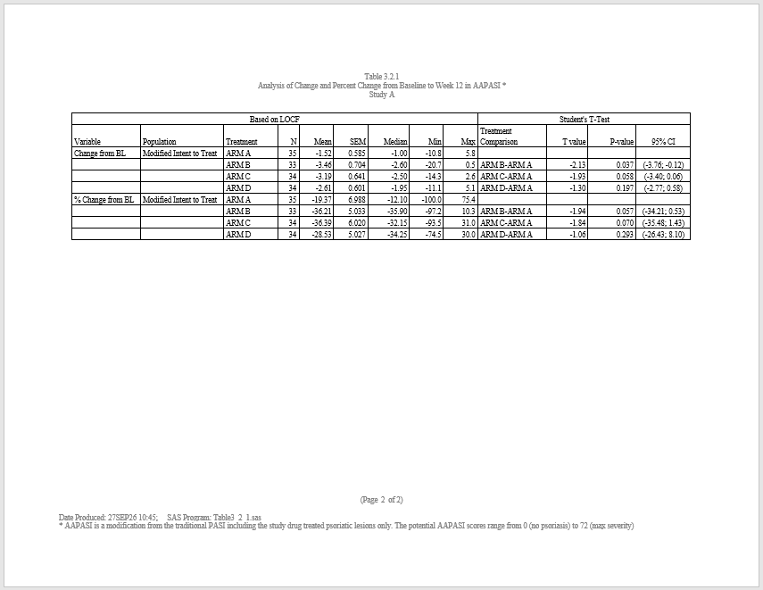

```{r setup, include = FALSE}
knitr::opts_chunk$set(
  collapse = TRUE,
  comment = "#>"
)
```
This example illustrates the use of the **[macro](https://macro.r-sassy.org)** 
package. The program produces a change and percent of change from baseline table 
for a treatment response score.  The table includes t and p values to 
determine whether or not that change is significant.  The table layout is 
interesting in that the same statistics are generated for different population 
groups, and the spanning header text is different for each page of the 
report. These requirements make this report a perfect use case for the SASSY
**macro** language.

## Program

Note the following about this example:

  * Macro variables set at the top of the program will be resolved to 
  real values in the code.
  * The "%sortdsn()" macro function provides a common sort routine which 
  is utilized in several places.
  * The "%statfreq()%" macro function is called for each population subset.
  * Inside the "%statfreq()%" macro, macro variables are resolved dynamically
  during pre-processing.
  * The `create_table()` function is called twice inside a macro "%do" loop.
  The header values are different for each page.  Both pages are added to the 
  report.
  
To execute this report, save the code to a file and run it using the `msource()`
function from the **macro** package, like this: `msource(<mypath>)`.
See the **[macro](https://macro.r-sassy.org)** package documentation for 
further details.


```{r eval=FALSE, echo=TRUE}

library(sassy)

#% Assign macro variables
#%let basename <- %sysfunc(gsub("\\\\", "/", tempdir()))
#%let Protocol <- Study A


# Get path to sample data
pkg <- system.file("extdata", package = "sassy")


# Macros ------------------------------------------------------------------


#% A Macro to sort several data sets by the same sort variables
#% data sets must reside in the same library
#%macro sortdsn(libname=, datasets=, sortvars=);

#%loop through all the data sets and sort them by common sort variables

#%do x = 1 %to %sysfunc(length(&datasets.))
#%let dsn <- %sysfunc(&datasets[&x])

# Sort &dsn. dataset
#%if (&libname == "")
#%let ldsn <- &dsn
#%else
#%let ldsn <- &libname.$&dsn
#%end
proc_sort(data=`&ldsn.`,
          by = `&sortvars`) -> `&dsn.`
#%end
#%mend sortdsn

# Program -----------------------------------------------------------------

options("logr.autolog" = TRUE,
        "logr.notes" = FALSE,
        "procs.print" = FALSE)

# Open log
lf <- log_open()

put("Load data")
libname(madam, pkg, "RData")


sep("Create formats")

put("Create format catalog")
fc <- fcat(N = '%2.f',
           MEAN = '%8.2f',
           STDERR = '%8.3f',
           MEDIAN = '%8.2f',
           MIN = '%8.1f',
           MAX = '%8.1f')

sep("BEGIN SECTION TO OBTAIN COUNTS AND PERCENTS AND FORMAT ACCORDINGLY")

#% macro to obtain the counts and p-values by each subset
#%macro statfreq(pop=, poplab=, locf=);


put("POP = &pop.")
put("LOCF = &locf.")

put("subset the source data set")
proc_sort(data=madam$adaapasi,
          where = expression(`&pop.` == 'Y' & DTYPE %in% c(NA, "&locf.") &
                               PARAMCD == 'PASISCOR' & AVISITN == 12 & ANL01FL == 'Y'),
          by = TRTA) -> adaapasi

put("obtain the summary stats for change and percent change from baseline")
proc_means(data=adaapasi,
           stats = c("n", "mean", "stderr", "median", "min", "max"),
           options = c("nway", "notype", "nofreq"),
           class = c("TRTA", "TRTAN"),
           var = c("CHG", "PCHG"),
           where = expression(!is.na(TRTA))) -> means&pop&locf

put("Format the summary stats for output")
datastep(means&pop&locf, format = fc,
         rename = c("CLASS1" = "TRTA", "CLASS2" = "source"),
         {
           POP = "&pop."
           if (VAR == "CHG")
             label <- "Change from BL"
           else
             label <- "% Change from BL"

         }) -> means2&pop&locf

put("Sort data for analysis")
proc_sort(data=adaapasi,
          by = "TRTA",
          order = "descending") -> adaapasi

put("loop through all comparator treatments to calculate the Student T Test" %p%
      "want ttest and CI based on TREAT X - TREAT A")
#%do i = 2 %to 4
put("Run ttest #&i")
proc_ttest(data = adaapasi,
           order = "data",
           plots = TRUE,
           class = "TRTA",
           var = c("CHG", "PCHG"),
           where = expression(TRTAN %in% c(1, `&i.`))) -> tt_&pop&locf.&i

put("Format Confidence Limits #&i")
datastep(tt_&pop&locf.&i$ConfLimits,
         subset = expression(METHOD == "Pooled" & CLASS == "Diff (1-2)"),
         keep = c("METHOD", "CLASS", "VAR", "source", "LCLM", "UCLM", "ci_95"),
         {
           source <- `&i`
           ci_95 <- paste0("(", fapply(LCLM, "%.2f"), "; ",
                           fapply(UCLM, "%.2f"), ")")
         }) -> ci&pop&locf&i

put("Format t-test and p-value #&i")
datastep(tt_&pop&locf.&i$TTests, subset = expression(METHOD == "Pooled"),
         keep = c("METHOD", "VAR", "source", "TVAL", "PVAL"),
         {
           source <- `&i`

           TVAL <- fapply(`T`, "%.2f")
           PVAL <- fapply(PROBT, "%.3f")
         }) -> tt&pop&locf&i

#%end

# Bind everything together
ci&pop&locf <- rbind(ci&pop&locf2, ci&pop&locf3, ci&pop&locf4)
tt&pop&locf <- rbind(tt&pop&locf2, tt&pop&locf3, tt&pop&locf4)

#%sortdsn(libname="", datasets=c("ci&pop&locf", "tt&pop&locf"),
#%>        sortvars=c("VAR", "source"))


put("combine the 95% CI and Ttest")
datastep(ci&pop&locf, merge = tt&pop&locf[, c("TVAL", "PVAL")],
         {
           if (source == "2")
             trtcomp <- "ARM B-ARM A"
           else if (source == "3")
             trtcomp <- "ARM C-ARM A"
           else if (source == "4")
             trtcomp <- "ARM D-ARM A"

           TRTA <- substr(trtcomp, 1, 5)

           if (VAR == "CHG")
             label <- "Change from BL"
           else
             label <- "% Change from BL"

         }) -> ci_tt&pop&locf


#% Sort means2 dataset
#%sortdsn(libname="", datasets=c("means2&pop&locf", "ci_tt&pop&locf"),
#%>       sortvars=c("TRTA", "label"))

put("combine all into one data set")
datastep(means2&pop&locf, merge = ci_tt&pop&locf,
         merge_by = c("VAR", "source", "TRTA", "label"),
         {}) -> all&pop&locf


#%sortdsn(libname="", datasets="all&pop&locf", sortvars=c("VAR", "source"))

#%mend statfreq;

put("obtain treatment counts for per protocol and modified intent-to-treat")
proc_freq(madam$adsl,
          where = expression(PPROTFL == "Y"),
          tables = "TRT01A*PPROTFL") -> pprot

proc_freq(madam$adsl,
          where = expression(MITTFL == "Y"),
          tables = "TRT01A*MITTFL") -> mitt


#% Calculate statistics for each population
#%statfreq(pop=PPROTFL, poplab=Per Protocol Population)
#%statfreq(pop=MITTFL, poplab=Modified Intent-to-Treat)
#%statfreq(pop=MITTFL, poplab=Modified Intent-to-Treat, locf=LOCF)

put("set up flags")
allPPROTFL$inds <- "a"
allMITTFL$inds <- "b"
allMITTFLLOCF$inds <- "c"

put("Combine all the population results into one data set")
datastep(allPPROTFL, set = list(allMITTFL, allMITTFLLOCF),
         keep = c("label", "VAR", "POP", "TRTA", "TRTAN", "N", "MEAN", "STDERR",
                  "MEDIAN", "MIN", "MAX", "trtcomp",
                  "TVAL", "PVAL", "ci_95",
                  "inds", "order", "page"),
         {

           if (inds %in% c("a", "c")) {
             order <- 1
           } else {
             order <- 2
           }

           if (inds %in% c("a", "b")) {
             page <- 1
           } else {
             page <- 2
           }

         }) -> all


put("Put data in correct order for display")
#%sortdsn(libname="", datasets="all", sortvars=c("page", "VAR", "order",  "TRTA"))


put("Manually blank out pop value")
datastep(all, by = c("VAR", "inds"), sort_check = FALSE,
         drop = c("VAR", "inds", "order"),
         {
           if (!first.VAR & !first.inds) {
             POP <- ""
           }
         }) -> final


sep("END SECTION TO OBTAIN COUNTS AND PERCENTS AND FORMAT ACCORDINGLY")

sep("BEGIN SECTION TO PRODUCE OUTPUT")

put("Create format for population")
popfmt <- value(condition(x == "PPROTFL", "Per Protocol Population"),
                condition(x == "MITTFL", "Modified Intent to Treat"),
                condition(x == "MITTFL1", "Modified Intent to Treat"),
                condition(TRUE, ""))

# write.csv(final, file = "./Mentor/data/final.csv")

# This is a two-page report, where the headers on the pages are not the same.
# So we create two tables, one for each page, and add them as two pieces of
# content. Spanning header is changed dynamically in the macro loop.
put("Create table for reporting")
#%do page = 1 %to 2
tbl&page. <- create_table(final[final$page == `&page`, ], borders = "all") |>
  #%if (&page == 1)
  spanning_header(from = label, to = MAX, label = "Based on Observed Cases") |>
  #%else
  spanning_header(from = label, to = MAX, label = "Based on LOCF") |>
  #%end
  spanning_header(from = trtcomp, to = ci_95, label = "Student's T-Test") |>
  define(label, align = "left", width = 1, label = "Variable", dedupe = TRUE) |>
  define(POP, align = "left", width = 1.2, label = "Population", format = popfmt) |>
  define(TRTA, align = "left", width = .8, label = "Treatment") |>
  define(N, align = "right", width = .3, label = "N") |>
  define(MEAN, align = "right", width = .5, label = "Mean") |>
  define(STDERR, align = "right", width = .5, label = "SEM") |>
  define(MEDIAN, align = "right", width = .6, label = "Median") |>
  define(MIN, align = "right", width = .5, label = "Min") |>
  define(MAX, align = "right", width = .5, label = "Max") |>
  define(trtcomp, align = "left", width = 1, label = "Treatment\nComparison") |>
  define(TVAL, align = "right", width = .6, label = "T value") |>
  define(PVAL, align = "right", width = .7, label = "P-value") |>
  define(ci_95, align = "center", width = .8, label = "95% CI") |>
  define(page, visible = FALSE, page_break = TRUE)
#%end

put("Create report object")
rpt <- create_report("&basename/output/example17.rtf", font = "Times",
                     font_size = 8, output_type = "RTF") |>
  set_margins(top = 1, bottom = .8, left = .8, right = .8) |>
  add_content(tbl1) |>
  add_content(tbl2) |>
  titles("Table 3.2.1",
         "Analysis of Change and Percent Change from Baseline to Week 12 in AAPASI *",
         "&Protocol", header = TRUE) |>
  footnotes("", '(Page [pg] of [tpg])', columns = 3, footer = TRUE) |>
  footnotes("Date Produced: %sysfunc(Sys.Date(),date7.) %sysfunc(Sys.time(), time5.);   SAS Program: Table3_2_1.sas",
            paste("* AAPASI is a modification from the traditional PASI including",
                  "the study drug treated psoriatic lesions only. The potential AAPASI scores range",
                  "from 0 (no psoriasis) to 72 (max severity)"), columns = 1, footer = TRUE)

put("Write out the report")
res <- write_report(rpt)


sep("END SECTION TO PRODUCE OUTPUT")


# Clean up ----------------------------------------------------------------


# Close log
log_close()

# Uncomment to view files
# file.show(res$path)
# file.show(lf)


```

## Output

Here are the two pages of the output report:





Next: [Example 18: Chinese Font](sassy-simsun.html)
