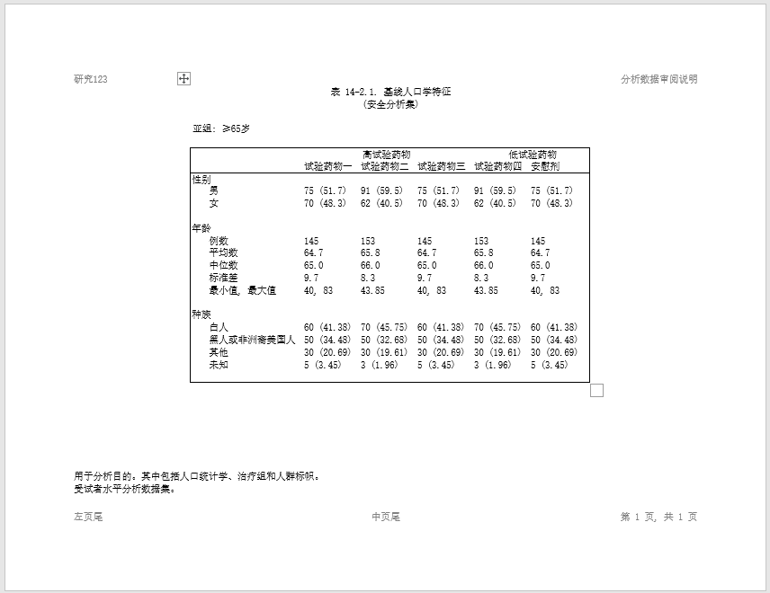

```{r setup, include = FALSE}
knitr::opts_chunk$set(
  collapse = TRUE,
  comment = "#>"
)
```
This example produces a demographics summary table of selected variables, 
but in Chinese. The Chinese text is generated with the "SimSun" font. 
The "SimSun" font is supported in TXT, HTML, DOCX, and RTF output types.
It is not supported in PDF. 

Here is a simple example in DOCX: 

## Program

```{r eval=FALSE, echo=TRUE}
library(reporter)

# Get temp location for report output
tmp <- tempdir()

# Define output path
fp <- file.path(tmp, "output/example18.docx")

# Read in prepared data
df <- read.table(header = TRUE, text = '
      group1   group2               trt1         trt2         subgroup
      "性别"   "男"                 "75 (51.7)"  "91 (59.5)"  "≥65岁"
      "性别"   "女"                 "70 (48.3)"  "62 (40.5)"  "≥65岁"
      "年龄"   "例数"               "145"        "153"        "≥65岁"
      "年龄"   "平均数"             "64.7"       "65.8"       "≥65岁"
      "年龄"   "中位数"             "65.0"       "66.0"       "≥65岁"
      "年龄"   "标准差"             "9.7"        "8.3"        "≥65岁"
      "年龄"   "最小值, 最大值"     "40, 83"     "43.85"      "≥65岁"
      "种族"   "白人"               "60 (41.38)" "70 (45.75)" "≥65岁"
      "种族"   "黑人或非洲裔美国人" "50 (34.48)" "50 (32.68)" "≥65岁"
      "种族"   "其他"               "30 (20.69)" "30 (19.61)" "≥65岁"
      "种族"   "未知"               "5 (3.45)"   "3 (1.96)"   "≥65岁"')

df$trt3 <- df$trt1
df$trt4 <- df$trt2
df$trt5 <- df$trt1

# Create table
tbl <- create_table(df, borders = "outside") |>
  titles("表 14-2.1. 基线人口学特征", "(安全分析集)") |>
  stub(c("group1", "group2")) |>
  page_by(subgroup,
          label = paste0("亚组:")) |>
  define(group1, label_row = T, blank_after = T) |>
  define(group2, indent = 0.25) |>
  define(trt1, label = "试验药物一") |>
  define(trt2, label = "试验药物二") |>
  define(trt3, label = "试验药物三") |>
  define(trt4, label = "试验药物四") |>
  define(trt5, label = "安慰剂") |>
  define(subgroup, visible = FALSE) |>
  spanning_header(from = "trt1", to = "trt3", label = "高试验药物") |>
  spanning_header(from = "trt4", to = "trt5", label = "低试验药物")


# Create report with SimSun font
rpt <- create_report(fp, output_type = "docx", font = "SimSun",
                     font_size = 10, orientation = "landscape") |>
  set_margins(top = 1, bottom = 1) |>
  page_header("研究123", "分析数据审阅说明") |>
  add_content(tbl, blank_row = "none") |>
  page_footer("左页尾", "中页尾", "第 [pg] 页, 共 [tpg] 页") |>
  footnotes("用于分析目的。其中包括人口统计学、治疗组和人群标帜。",
            "受试者水平分析数据集。")

# Write report to file system
res <- write_report(rpt)


# Uncomment to view report
# file.show(res$path)


```

## Output

Here is the output report:




<!-- Next: [Example 3: Figures](sassy-figure.html)-->
