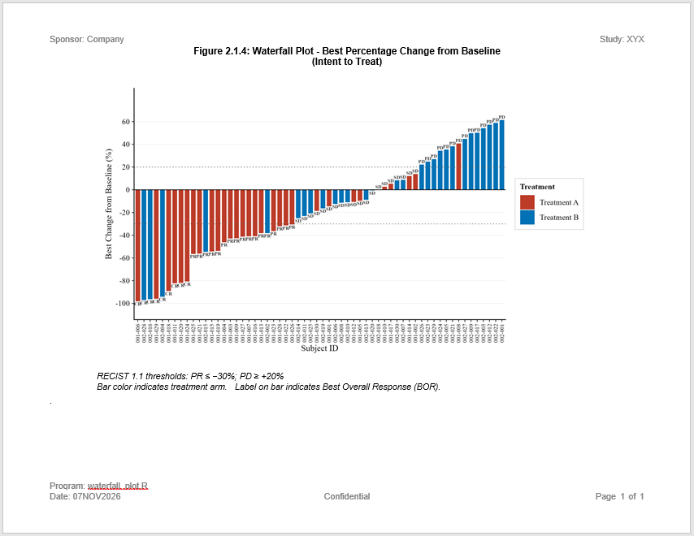

```{r setup, include = FALSE}
knitr::opts_chunk$set(
  collapse = TRUE,
  comment = "#>"
)
```
This example produces a waterfall plot to identify patients with the best
percentage change from baseline. Waterfall plots are used in many industries.

## Program

```{r eval=FALSE, echo=TRUE}
library(ggplot2)
library(sassy)


options("logr.autolog" = TRUE,
        "logr.notes" = FALSE,
        "procs.print" = FALSE)

# Get temp location for log and report output
tmp <- tempdir()

# Open log
lf <- log_open(file.path(tmp, "example19.log"))


# Get path to sample data
pkg <- system.file("extdata", package = "sassy")

# Get data
libname(adam, pkg, "RData")


# Prepare data ------------------------------------------------------------

sep("Prepare data")

adrs <- adam$adrs

put("Get unique treatment values")
arm_levels <- proc_sort(adrs, by = TRTA, options = nodupkey ,
                        keep = TRTA)

put("Convert to vector")
arm_levels <- arm_levels[["TRTA"]]

put("Sort data and convert to factors")
df <- proc_sort(adrs, by = PCHG)
df$USUBJID <- factor(df$USUBJID , levels = df$USUBJID)
df$TRTA <- factor(df$TRTA, levels = arm_levels)


put("Set up named vector for ARM columns")
ARM_COLS <- c("#BC3C29", "#0072B5")
names(ARM_COLS) <- arm_levels

put(ARM_COLS)


# Create plot -------------------------------------------------------------

sep("Create plot")

p <- ggplot(df,
            aes(x = USUBJID, y = PCHG, fill = TRTA)) +

  # Bars — one per subject, coloured by treatment arm
  geom_col(width = 0.8, color = "white", linewidth = 0.15) +

  # BOR label at top of each bar
  # Positive bars: label above bar (vjust < 0)
  # Negative bars: label below bar end (vjust > 1)
  geom_text(
    aes(label = BOR,
        vjust = ifelse(PCHG >= 0, -0.4, 1.3)),
    size     = 2.0,
    family   = "serif",
    color    = "grey20",
    fontface = "bold"
  ) +

  # RECIST 1.1 reference lines
  # +20%: Progressive Disease threshold
  geom_hline(yintercept =  20,
             linetype = "dotted", color = "grey40",
             linewidth = 0.4) +
  # -30%: Partial Response threshold
  geom_hline(yintercept = -30,
             linetype = "dotted", color = "grey40",
             linewidth = 0.4) +
  # Zero baseline
  geom_hline(yintercept =   0,
             color = "black", linewidth = 0.35) +

  # Colour scale — named dynamically from arm_levels
  scale_fill_manual(
    values = ARM_COLS,
    name   = "Treatment"
  ) +

  # Y-axis — plain numbers, no % symbol
  # % indicated in axis title instead
  scale_y_continuous(
    limits = c(-105, 80),
    breaks = seq(-100, 60, 20),
    labels = function(x) as.character(x)
  ) +

  # X-axis — USUBJID labels, rotated 90°
  scale_x_discrete() +

  # Labels
  labs(
    x        = "Subject ID",
    y        = "Best Change from Baseline (%)"
  ) +

  # Theme — publication-ready
  theme_classic(base_size = 11, base_family = "serif") +
  theme(
    plot.title         = element_text(size = 12, face = "bold",
                                      hjust = 0,
                                      margin = margin(b = 3)),
    plot.subtitle      = element_text(size = 8.5, color = "grey50",
                                      hjust = 0,
                                      margin = margin(b = 10)),
    axis.title         = element_text(size = 10),
    axis.text.y        = element_text(size = 9, color = "black"),
    axis.text.x        = element_text(size = 6.5, color = "black",
                                      angle = 90,
                                      hjust = 1, vjust = 0.5),
    axis.line          = element_line(linewidth = 0.4),
    axis.ticks         = element_line(linewidth = 0.3),
    panel.grid.major.y = element_line(color = "grey93",
                                      linewidth = 0.25),
    panel.grid.major.x = element_blank(),
    panel.grid.minor   = element_blank(),
    legend.position    = "right",
    legend.background  = element_rect(fill  = "white",
                                      color = "grey80",
                                      linewidth = 0.25),
    legend.text        = element_text(size = 9),
    legend.title       = element_text(size = 9, face = "bold"),
    plot.margin        = margin(12, 16, 8, 10)
  )


# Create Report -----------------------------------------------------------

sep("Create Report")

put("Create output path")
pth <- file.path(tmp, "output/example19.rtf") |> put()

put("Create plot object")
plt <- create_plot(p,
                   height = 4.5,
                   width  = 8.0) |>
  titles(
    "Figure 2.1.4: Waterfall Plot - Best Percentage Change from Baseline",
    "(Intent to Treat)", bold = TRUE, font_size = 11) |>
  footnotes(
    "RECIST 1.1 thresholds: PR \u2264 \u221230%; PD \u2265 +20%",
    "Bar color indicates treatment arm.  Label on bar indicates Best Overall Response (BOR).",
    italics = TRUE)

put("Create report")
rpt <- create_report(pth,
                     output_type = "RTF",
                     orientation = "landscape",
                     font = "Arial") |>
  set_margins(top    = 0.5, bottom = 0.5,
              left   = 0.75, right = 0.75) |>
  page_header("Sponsor: Company", right = "Study: XYX") |>
  add_content(plt, align = "center")  |>
  footnotes("Program: waterfall_plot.R", footer = TRUE) |>
  page_footer("Date: {fapply(Sys.Date(), 'date9')}", "Confidential",
              "Page [pg] of [tpg]")

put("Write report to file")
res <- write_report(rpt)


# Clean up ----------------------------------------------------------------

log_close()


# Comment in to view report and log
# file.show(res$path)
# file.show(lf)


```

## Output

Here is the output report:




## Log

Here is the log:
```
=========================================================================
Log Path: C:/Users/dbosa/AppData/Local/Temp/RtmpK6lTDb/log/example19.log
Program Path: C:/Studies/Validation/Gallery/P19.R
Working Directory: C:/Studies/Validation
User Name: dbosa
R Version: 4.6.1 (2026-06-24 ucrt)
Machine: SOCRATES x86-64
Operating System: Windows 10 x64 build 26200
Base Packages: stats graphics grDevices utils datasets methods base
Other Packages: tidylog_1.1.0 macro_0.1.6 procs_1.1.0 reporter_1.5.0 libr_1.4.2
logr_1.4.1 fmtr_1.7.3 common_1.1.5 sassy_1.3.3 ggplot2_4.0.3
Log Start Time: 2026-11-07 07:19:58.031582
=========================================================================

# library 'adam': 3 items
- attributes: RData not loaded
- path: C:/Users/dbosa/AppData/Local/R/win-library/4.6/sassy/extdata
- items:
      Name Extension Rows Cols     Size        LastModified
1 adaapasi     RData  985   44 388.4 Kb 2026-11-07 07:05:14
2     adrs     RData   60    4   9.2 Kb 2026-11-07 07:05:14
3     adsl     RData  152   56 116.1 Kb 2026-11-07 07:05:14

=========================================================================
Prepare data
=========================================================================

Get unique treatment values

proc_sort: input data set 2 rows and 4 columns
           by: TRTA
           keep: TRTA
           order: a
           options: nodupkey
           as.character: FALSE
           na.sort: last
           output data set 2 rows and 1 columns

# A tibble: 2 × 1
  TRTA       
  <chr>      
1 Treatment A
2 Treatment B

Convert to vector

Sort data and convert to factors

proc_sort: input data set 60 rows and 4 columns
           by: PCHG
           keep: USUBJID TRTA BOR PCHG
           order: a
           as.character: FALSE
           na.sort: last
           output data set 60 rows and 4 columns

# A tibble: 60 × 4
   USUBJID TRTA        BOR    PCHG
   <chr>   <chr>       <chr> <dbl>
 1 001-006 Treatment A CR    -98.3
 2 002-028 Treatment B CR    -97.2
 3 002-016 Treatment B CR    -96.4
 4 001-029 Treatment A CR    -96  
 5 002-004 Treatment B CR    -94.3
 6 001-018 Treatment A CR    -89.2
 7 001-011 Treatment A CR    -82.4
 8 001-020 Treatment A CR    -82  
 9 001-024 Treatment A CR    -80.8
10 001-025 Treatment A PR    -56.6
# ℹ 50 more rows
# ℹ Use `print(n = ...)` to see more rows

Set up named vector for ARM columns

#BC3C29
#0072B5

=========================================================================
Create plot
=========================================================================

=========================================================================
Create Report
=========================================================================

Create output path

C:\Users\dbosa\AppData\Local\Temp\RtmpK6lTDb/output/example19.rtf

Create plot object

Create report

Write report to file

# A report specification: 1 pages
- file_path: 'C:\Users\dbosa\AppData\Local\Temp\RtmpK6lTDb/output/example19.rtf'
- output_type: RTF
- units: inches
- orientation: landscape
- margins: top 0.5 bottom 0.5 left 0.75 right 0.75
- lines per page: 42
- content width: 9.5
- content height: 7.5
- line height: 0.17
- page_header: left=Sponsor: Company right=Study: XYX
- page_footer: left=Date: 07NOV2026 center=Confidential right=Page [pg] of [tpg]
- content: 
# A plot specification: 
- data: 60 rows, 4 cols
- layers: 5
- height: 4.5
- width: 8
- title 1: 'Figure 2.1.4: Waterfall Plot - Best Percentage Change from Baseline'
- title 2: '(Intent to Treat)'
- footnote 1: 'RECIST 1.1 thresholds: PR ≤ −30%; PD ≥ +20%'
- footnote 2: 'Bar color indicates treatment arm.  Label on bar indicates Best Overall Response (BOR).'

=========================================================================
Log End Time: 2026-11-07 07:19:59.42934
Log Elapsed Time: 0 00:00:01
=========================================================================

```

<!--Next: [Example 3: Figures](sassy-figure.html)-->
